<div align="center">

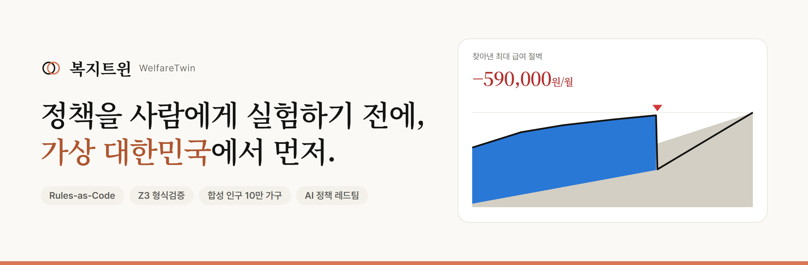

# 복지트윈 WelfareTwin

### 정책을 사람에게 실험하기 전에, 가상 대한민국에서 먼저

사회보장제도를 **실행 가능한 코드(Rules-as-Code)** 로 바꾸고, **Z3 형식검증**으로 사각지대·급여 절벽·중복을 수학적으로 찾고,<br>
**합성 인구 10만 가구 + AI 에이전트**로 정책 변화를 미리 돌려 보는 **정책 디지털 트윈**

2026 사회보장 데이터를 활용한 AI 혁신 아이디어 경진대회 출품작

[](https://welfaretwin.vercel.app)
[](pyproject.toml)
[](src/welfaretwin/verify)
[](src/welfaretwin/agents/llm.py)
[](app/dashboard.py)
[](tests)
[](https://welfaretwin-api.vercel.app/docs)
[-2ea44f?style=flat-square)](#데이터-출처개인정보ai-활용)

**[웹 데모 열기](https://welfaretwin.vercel.app)** · [평가 리포트](reports/eval_20261110.md) · [발표 대본](docs/12_발표_대본.md) · [질의응답 대비표](docs/11_질의응답_대비표.md) · [구현계획서](docs/01_구현계획서.md)

</div>

<p align="center">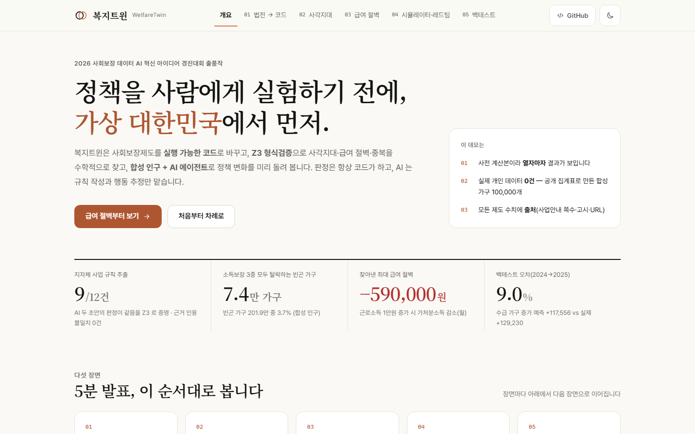</p>
<p align="center"><sub>웹 데모 첫 화면 — 2026-11-10 캡처(1440×900). 화면 수치는 사전 계산본(결과 생성 2026-11-10) 기준입니다.</sub></p>

> [!IMPORTANT]
> **판정은 항상 코드가 합니다.** LLM 은 규칙 초안 작성(이중 생성 → Z3 교차검증 → 사람 승인)과 신청 행동 추정(실제 수급 통계로 보정)에만 씁니다.
> 실제 개인 단위 데이터는 쓰지 않습니다. 공개 집계표로 만든 **합성 가구**만 씁니다.

## 한눈에 보기

- **규칙:** 중앙 제도 7종(생계·의료·주거·교육급여, 기초연금, 에너지바우처, 근로장려금)은 사람이 작성했고, 대구·경북 지자체 사업 12건은 LLM 이 추출했습니다. A·B 두 초안의 판정 동치 증명 9건, 불일치 3건(반례로 누락 조건 발견), 근거 인용 불일치 0건입니다.
- **사각지대:** Z3 가 2.61초 만에 서로 다른 유형 8개를 찾았습니다. 합성 인구 기준 빈곤 가구 2,019,145 중 **73,783가구(3.7%)** 가 소득보장 3종(생계급여·기초연금·근로장려금)에서 모두 탈락합니다.
- **급여 절벽:** 근로소득이 1만원 늘 때 가처분소득이 **최대 590,000원(월)** 줄어드는 가구를 찾았습니다.
- **정책 시뮬레이션:** 현행 수급률 75.5%, 자격은 있으나 미신청 651,656가구. 자동 안내(S1)는 수급 +312,897가구·월 재정 +923억원, 생계급여 선정기준 32→35% 는 생계 자격 +216,176가구·월 재정 +1,266억원입니다(기초생활보장 전체 자격은 그대로). 신청 행동은 **가상 국민 714명**(합성 인구 238개 유형 × 통계 기반 가상 인물 3명, NVIDIA Nemotron-Personas-Korea)이 1인칭으로 답한 값을 실제 수급 통계로 보정했습니다.
- **백테스트(2024→2025):** 수급 가구 증가 예측 +117,426 vs 실제 +129,230, **오차율 9.1%** 로 목표 ±10% 를 달성했습니다. 인원 기준 오차율은 16.8% 입니다.

| 지표 | 값 | 목표 | 판정 |
|---|---|---|---|
| 지자체 사업 규칙 A·B 동치 | 9/12건 (인용 불일치 0) | 불일치는 반례로 검수 | 불일치 3건 모두 사람 검수 후 승인 |
| 평가기–Z3 일관성 | 무작위 1,000가구 100% 일치 | 100% | 달성 |
| 합성 인구 주변분포 오차 | 최대 0.05%p (시도·가구원수·점유형태·연령) | ±2%p | 달성 |
| 백테스트 가구 오차율 | **9.1%** (보정 전 76.4%) | ±10% | 달성 |
| 백테스트 인원 오차율 | 16.8% | ±10% | **미달** |
| 데모 화면 응답 | 최대 3.7초 (리허설 3회 연속 무오류) | 30초 | 달성 |

수치는 모두 [`reports/eval_20261110.md`](reports/eval_20261110.md) 에서 가져왔습니다(`uv run python -m welfaretwin.report_eval` 로 다시 만듭니다).

## 목차

[문제와 접근](#문제와-접근) · [웹 데모 둘러보기](#웹-데모-둘러보기) · [실시간 계산 서버](#실시간-계산-서버) · [시스템 구조](#시스템-구조) · [Rules-as-Code](#rules-as-code) · [형식검증](#형식검증z3) · [가상 대한민국](#가상-대한민국합성-인구--ai-에이전트) · [백테스트](#백테스트) · [빠른 시작과 재현](#빠른-시작과-재현) · [저장소 구조](#저장소-구조) · [한계](#한계) · [FAQ](#faq) · [문서 지도](#문서-지도) · [출처·개인정보·AI 활용](#데이터-출처개인정보ai-활용)

## 문제와 접근

### 왜 필요한가

사회보장제도는 제도마다 선정기준이 다르고, 서로의 급여가 소득인정액에 다시 들어가 얽혀 있습니다. 그래서 "빈곤선 아래인데 어느 제도도 받지 못하는 가구가 있는가", "소득이 조금 늘었는데 손에 쥐는 돈이 줄어드는 구간이 있는가" 같은 질문은 제도 문서를 읽어서는 답하기 어렵습니다. 바꾼 정책의 효과도 시행해 봐야 압니다.

복지트윈은 세 단계로 이 질문에 답합니다.

1. **규칙을 코드로.** 선정기준을 실행 가능한 규칙(YAML DSL)으로 옮깁니다. 모든 제도 수치에는 출처(사업안내 쪽수·고시·URL)를 붙입니다.
2. **샘플링이 아니라 증명으로.** 규칙 전체를 Z3 제약식으로 바꿔 "이런 가구가 존재하는가"를 묻습니다. 존재하면 구체적인 가구와 탈락 조항을 돌려줍니다.
3. **사람에게 시행하기 전에 가상으로.** 합성 인구 10만 가구와 가상 국민(AI 에이전트) 714명으로 정책 변화를 미리 돌려 보고, 과거 제도 변화를 재현해 오차를 공개합니다.

### Z3 에 던지는 세 가지 질문

| 질의 | 묻는 것 | 결과(2026-11-10) |
|---|---|---|
| Q1 사각지대 | 소득인정액 ≤ 기준중위소득 40% 인데 생계급여·기초연금·근로장려금에서 **모두** 탈락하는 가구가 있는가 | 8개 유형, 2.61초 |
| Q2 급여 절벽 | 가구주 근로소득 +1만원에 가처분소득(본인 소득 + 모든 현금 급여)이 줄어드는 가구가 있는가, 가장 크게 줄어드는 곳은 | 상위 5건, 최대 590,000원 |
| Q3 중복·사문화 | 아무도 받을 수 없는 규칙(사문화), 서로 배제한다고 선언했는데 동시에 받는 쌍이 있는가 | 사문화 0건, 배제 선언 쌍 0개 |

## 웹 데모 둘러보기

주소: **https://welfaretwin.vercel.app** · 발표 순서대로 다섯 장면 + 개요 · 라이트/다크 · 모바일 지원

웹은 대시보드 5개 화면의 **사전 계산본**을 먼저 보여 줘서 열자마자 결과가 보입니다. [실시간 계산 서버](#실시간-계산-서버)에 붙으면(헤더 '실시간 계산' 표시) 화면 안에서 직접 다시 계산합니다.

- **03 급여 절벽:** '직접 만들기'로 가구(지역·주거·재산·가구원)를 입력해 소득 스윕, 슬라이더 위치 소득에서 제도별 자격·급여·탈락 사유 표, Z3 절벽 재탐색
- **02 사각지대:** 빈곤선(20~60%)과 제도 조합을 바꿔 Z3 재탐색. 그런 가구가 없으면 '없음'을 증명했다고 표시
- **04 가상 대한민국 시뮬레이션:** 생계급여 선정기준 슬라이더(25~40%)와 신청 방식(현행 신청 ↔ 자동 안내)을 움직이면 그 자리에서 — 시도 지도(타일 색 = 새로 혜택받는 가구 비율, 점 = 가상 국민 714명의 상태), 수급 가구·미신청 사각지대·생계급여 수급·월 재정의 현행 대비 변화, 재정 1억 원당 새 수급 가구, 연령대별 혜택, 한 줄 요약이 바뀝니다. '12개월 재생'은 사람들이 차례로 신청하는 과정을, 점을 누르면 그 사람의 1인칭 이유를 보여 줍니다. 숫자는 16개 선정기준 × 2개 신청 방식을 합성 인구 10만 가구 전체로 미리 계산한 값(`sim/policy_grid.py`, 시나리오 엔진과 같은 값 — 테스트)
- **04 서버 재계산:** 같은 손잡이를 실시간 서버에서 다시 계산(합성 인구 1만 가구 표본)

서버에 연결되지 않으면 사전 계산본이 그대로 나오고 실시간 버튼만 비활성화됩니다(가상 대한민국 시뮬레이션은 서버 없이도 동작).

<p align="center">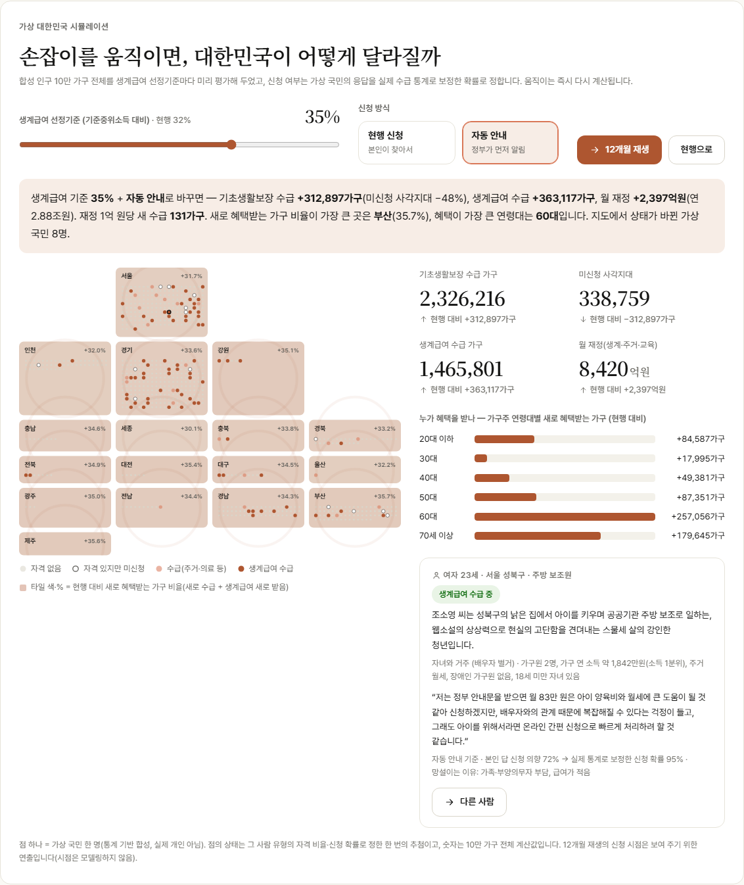</p>
<p align="center"><sub>가상 대한민국 시뮬레이션(2026-11-11 캡처) — 생계급여 기준 35% + 자동 안내: 수급 +312,897가구(미신청 사각지대 −48%), 생계급여 수급 +363,117가구, 월 재정 +2,397억원(연 2.88조원), 혜택이 가장 큰 연령대 60대.</sub></p> 사업안 자연어 입력(LLM)은 공개 서버에서 하지 않고 로컬 Streamlit 대시보드에서 합니다.

<table>
  <tr>
    <td width="50%" valign="top">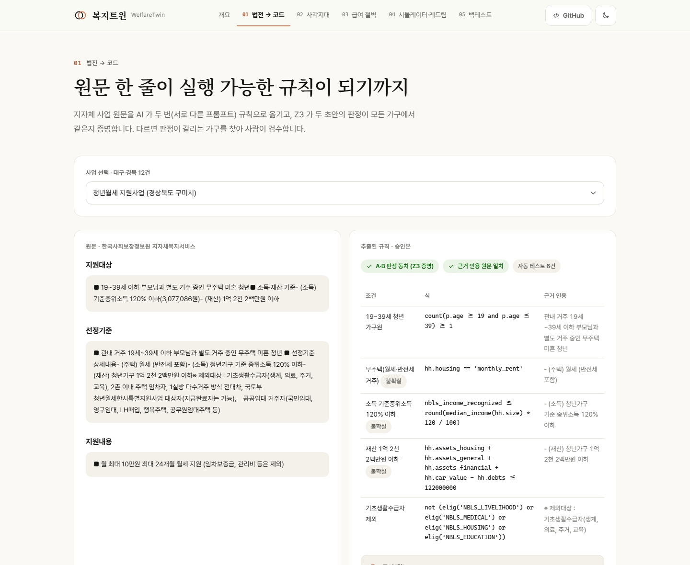<br><b>01 법전 → 코드</b> <code>/#rules</code><br><sub>2026-11-10 캡처. 경북 구미시 청년월세 지원사업의 원문(왼쪽)과 승인된 규칙(오른쪽). A·B 판정 동치(Z3 증명), 근거 인용 원문 일치, 자동 테스트 6건 배지와 규칙으로 표현하지 못한 조건 7개.</sub></td>
    <td width="50%" valign="top">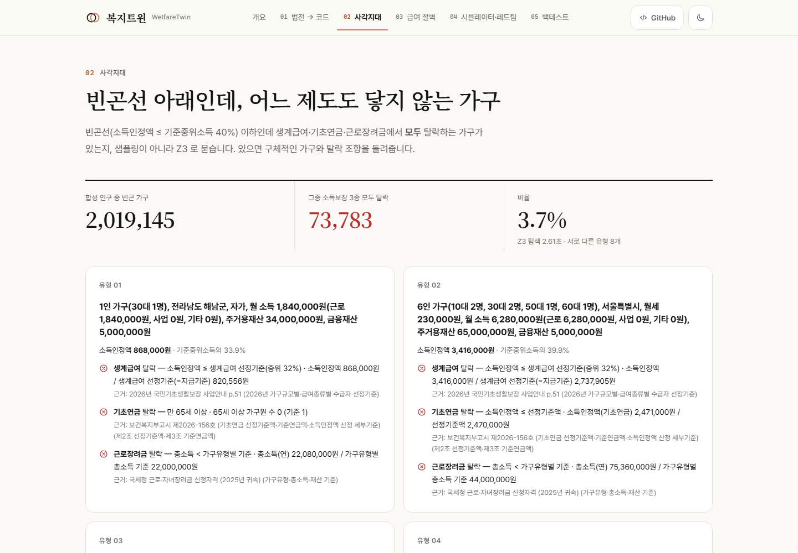<br><b>02 사각지대</b> <code>/#blind</code><br><sub>2026-11-10 캡처. 빈곤 가구 2,019,145 중 소득보장 3종 모두 탈락 73,783가구(3.7%). 유형마다 구체적인 가구와 제도별 탈락 조항·근거를 보여 줍니다.</sub></td>
  </tr>
  <tr>
    <td width="50%" valign="top">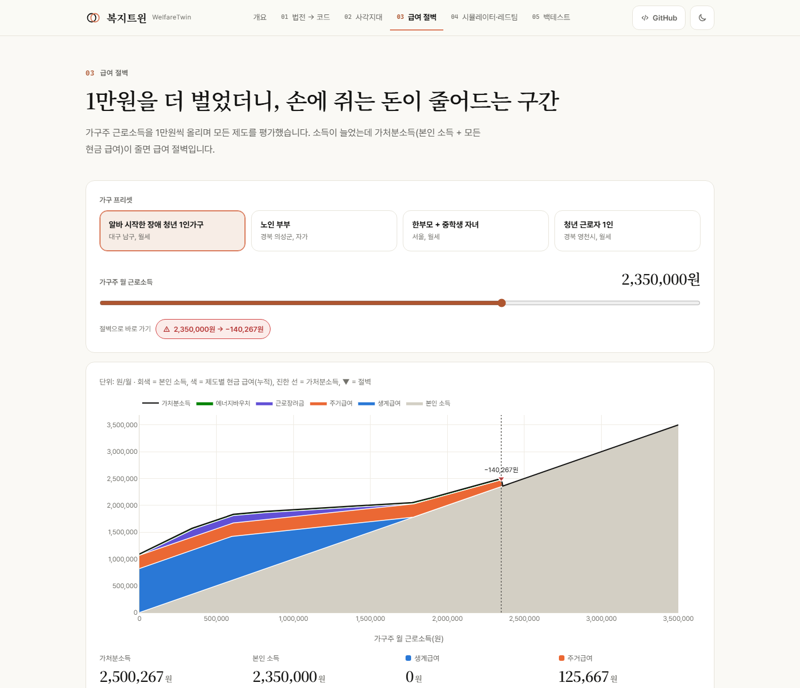<br><b>03 급여 절벽</b> <code>/#cliff</code><br><sub>2026-11-10 캡처. 프리셋 '알바 시작한 장애 청년 1인가구(대구 남구, 월세)'에서 '절벽으로 바로 가기'를 누른 상태 — 근로소득 2,350,000원에서 1만원 더 벌면 가처분소득 −140,267원. 회색은 본인 소득, 색은 제도별 현금 급여(누적), 진한 선은 가처분소득.</sub></td>
    <td width="50%" valign="top">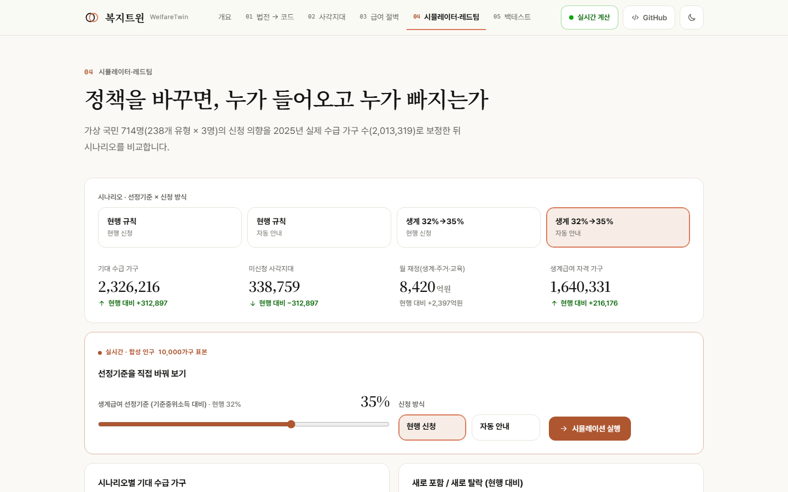<br><b>04 시뮬레이터</b> <code>/#sim</code><br><sub>2026-11-11 캡처(실시간 계산 연결). 가상 국민 714명의 신청 의향을 실제 수급 통계로 보정. 선정기준(현행 / 생계 32→35%) × 신청 방식(현행 신청 / 자동 안내) 4개 시나리오. 기대 수급·미신청·월 재정·생계 자격의 현행 대비 변화와, 선택한 시나리오를 강조한 막대그래프.</sub></td>
  </tr>
  <tr>
    <td width="50%" valign="top">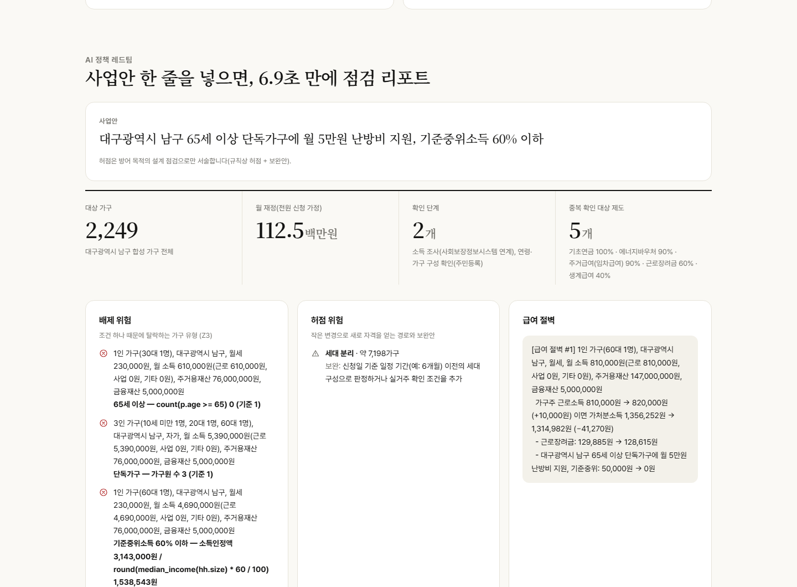<br><b>04 AI 정책 레드팀</b> <code>/#sim</code> 아래<br><sub>2026-11-10 캡처. 사업안 '대구광역시 남구 65세 이상 단독가구에 월 5만원 난방비 지원, 기준중위소득 60% 이하' → 6.9초 만에 대상 2,249가구·배제 위험·허점과 보완안·급여 절벽 리포트.</sub></td>
    <td width="50%" valign="top">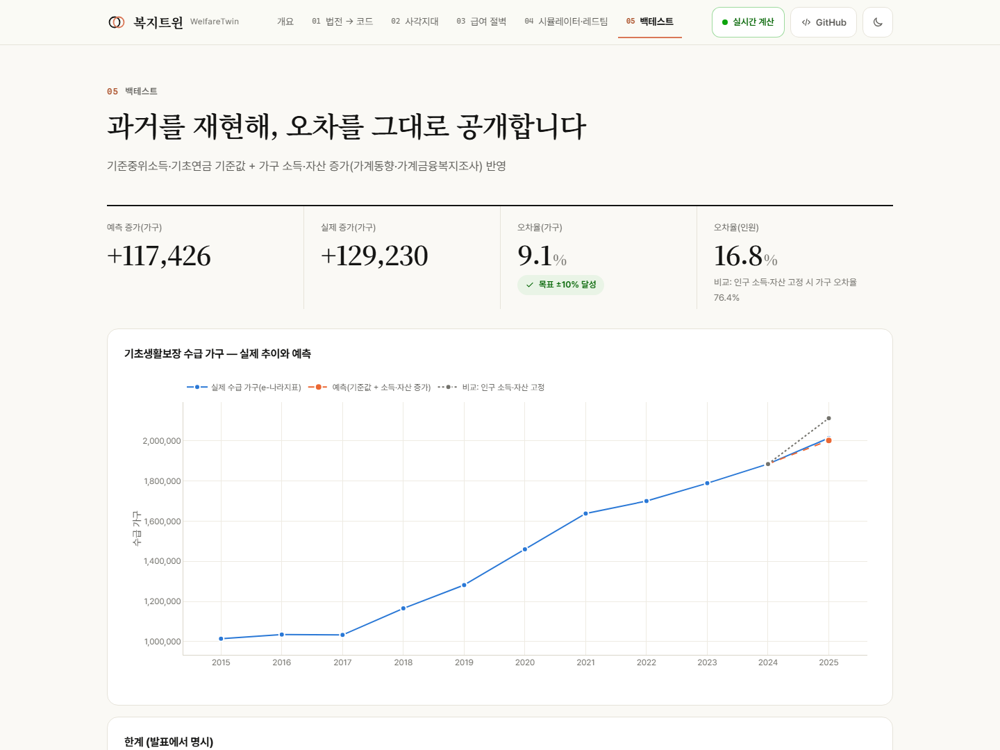<br><b>05 백테스트</b> <code>/#bt</code><br><sub>2026-11-11 캡처. 2024→2025 수급 가구 증가 예측 +117,426 vs 실제 +129,230(오차율 9.1%), 인원 오차율 16.8%, 소득·자산 고정 시 76.4%. 실제 추이(e-나라지표)와 예측선, 한계와 출처.</sub></td>
  </tr>
  <tr>
    <td width="50%" valign="top" align="center">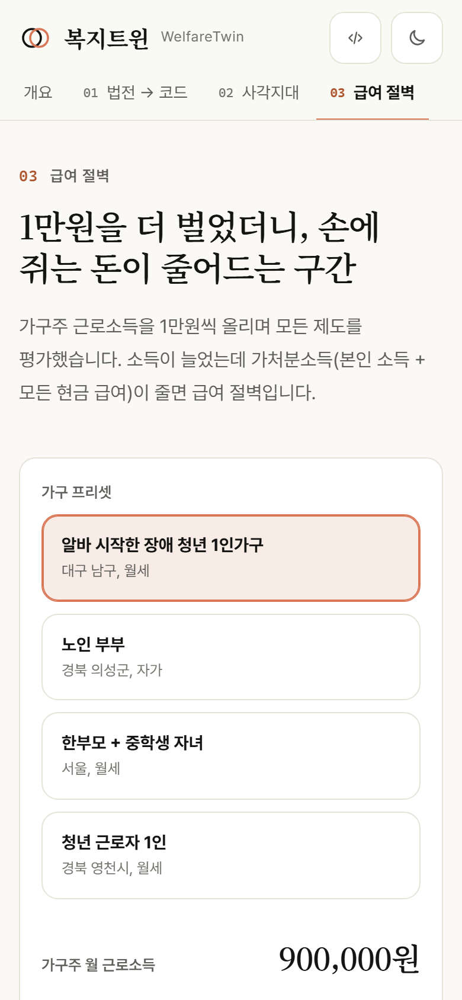 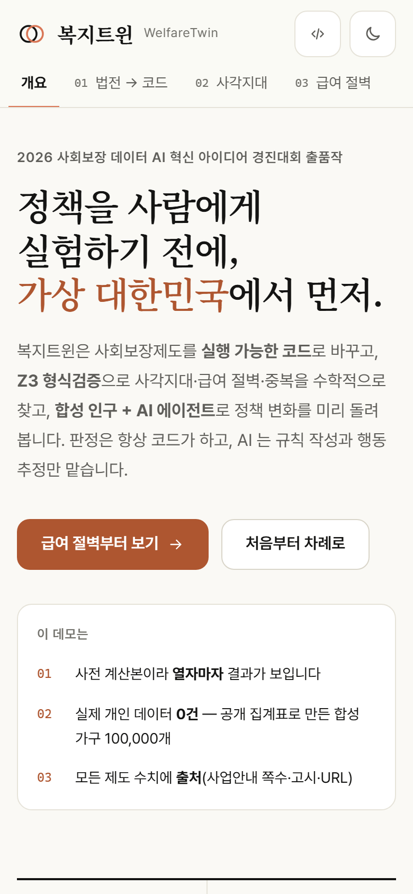<br><sub>모바일(390×844) 급여 절벽·개요, 2026-11-10 캡처. 장면 탭은 가로로 밀어 넘기고, 카드는 세로로 쌓입니다.</sub></td>
    <td width="50%" valign="top">
      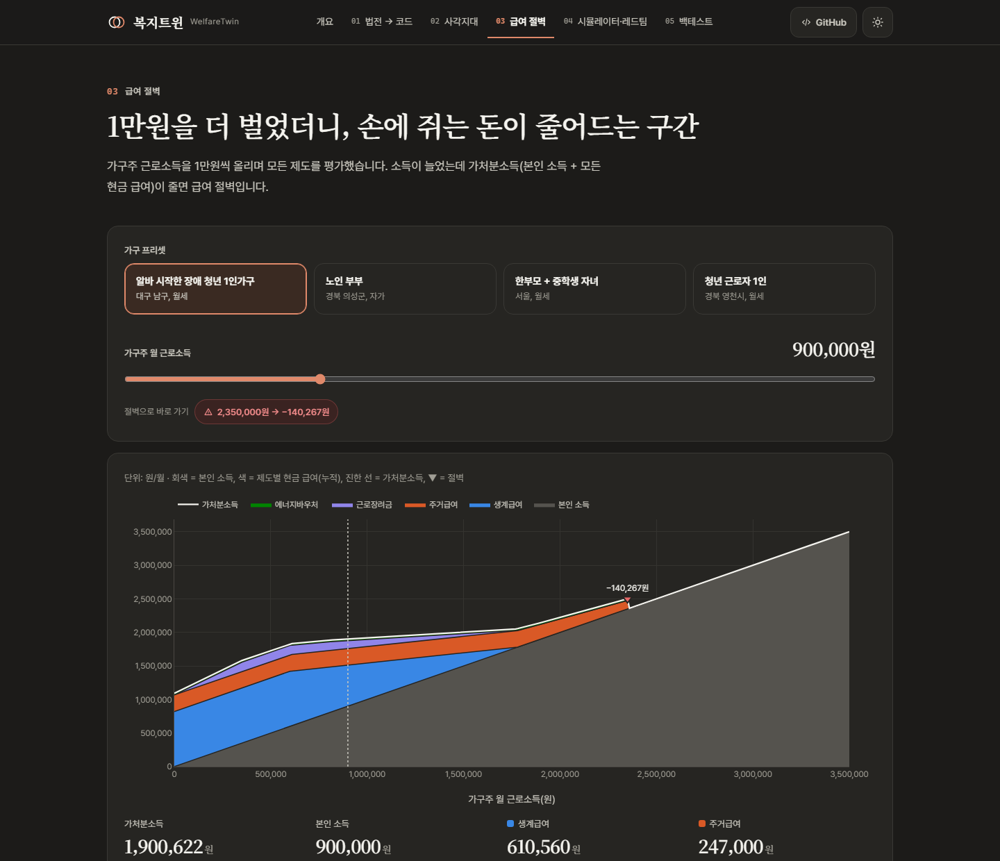<br><sub>다크 모드(시스템 설정을 따르고, 오른쪽 위 버튼으로 바꿈). 차트 색은 모드별로 따로 고른 단계이며, 누적 순서의 인접한 색 쌍은 색각 이상 시뮬레이션 검증을 통과합니다.</sub>
      <br><br><b>주소</b>
      <ul>
        <li><code>/#home</code> 개요 · <code>/#rules</code> 01 · <code>/#blind</code> 02 · <code>/#cliff</code> 03 · <code>/#sim</code> 04 · <code>/#bt</code> 05</li>
        <li>장면마다 아래 '이전/다음 장면'으로 발표 순서대로 넘어갑니다</li>
      </ul>
    </td>
  </tr>
</table>

## 실시간 계산 서버

웹이 부르는 FastAPI 서버([`src/welfaretwin/api/main.py`](src/welfaretwin/api/main.py))입니다. 주소 **https://welfaretwin-api.vercel.app** (자동 문서 [`/docs`](https://welfaretwin-api.vercel.app/docs)) — Vercel Python 함수(서울 리전, 1 vCPU)로, 정적 웹과 별도 프로젝트라 서버에 문제가 생겨도 웹은 그대로입니다. 대시보드·정적 웹과 **같은 엔진·같은 승인 규칙**으로 계산하고, 서버의 소득 스윕 결과는 정적 웹 데이터와 값이 같습니다(`tests/test_api.py`).

| 경로 | 하는 일 | 응답(Vercel 실측) |
|---|---|---|
| `POST /evaluate` | 가구 → 제도별 자격·급여·탈락 사유, 소득인정액, 가처분소득 | 0.1초 |
| `POST /sweep` | 가구 → 근로소득 구간별 제도 급여·가처분소득(급여 절벽) | 1.7~2초 |
| `POST /verify/blindspot` | 빈곤선·제도 조합 → Z3 사각지대 반례 또는 '없음' 증명 | 4~13초 |
| `POST /verify/cliff` | 소득 증가폭 → Z3 급여 절벽 반례(Z3 계산량 예산을 제도별로 나눠 탐색 — 같은 조건이면 항상 같은 결과) | 21초 |
| `POST /scenario` | 생계급여 선정기준·신청 방식 → 수급·재정 변화 | 20초(같은 값 다시: 0.4초) |
| `GET /health` · `/programs` · `/regions` | 상태, 승인 규칙 목록, 시도·시군구 | — |

- **공개 서버라 LLM 은 부르지 않습니다.** 무거운 계산(Z3·시나리오)은 한 번에 하나, IP 당 분당 6회까지 받고, 브라우저 호출(CORS)은 웹 데모 주소만 허용합니다.
- 시나리오 기준선(현행 규칙·같은 표본)은 사용자 입력과 무관한 고정값이라 배포할 때 미리 계산해 넣고, 서버 표본과 가구가 같을 때만 씁니다 — 요청마다 변경안만 계산합니다(60초 → 20초, 결과 동일 `tests/test_api.py`).
- Z3 급여 절벽 재탐색은 벽시계 대신 **Z3 계산량(rlimit)** 을 예산으로 쓰고 탐색마다 새 Z3 컨텍스트에서 풀어, 서버 CPU 속도와 무관하게 같은 조건이면 항상 같은 절벽을 찾습니다(Vercel 3회·개발 PC 모두 590,000 · 549,520 · 190,000 · 95,625원). 벽시계 예산일 때는 같은 요청에 0~4개로 달라졌습니다.
- 실시간 시나리오는 응답 시간 때문에 합성 인구 **1만 가구 표본**으로 계산합니다. 10만 가구 전체 계산과 약 10% 차이가 날 수 있어(생계 35% 시 자격 증가 +19.6만 vs +21.6만) 화면에 표본 계산이라고 적었습니다. 위 [한눈에 보기](#한눈에-보기) 수치는 전체 계산본입니다.

```bash
uv run uvicorn welfaretwin.api.main:app --port 7860                    # 로컬 서버(자동 문서 /docs)
# 웹을 로컬 서버에 붙이기: http://localhost:8790/?api=http://localhost:7860  (web/ 를 8790 포트로 띄운 경우)
uv run python scripts/deploy_api.py --deploy                          # Vercel 배포(별도 프로젝트 welfaretwin-api, Vercel CLI 로그인 필요)
uv run python scripts/deploy_api.py --target space                    # Docker 이미지 묶음(dist/space) — Hugging Face Space 는 무료 CPU 에 PRO 필요
```

`deploy_api.py` 는 허용 목록에 있는 파일(코드·승인 규칙·params·합성 인구·수급 통계)과 API 가 쓰는 패키지만(LLM·대시보드 제외, 로컬과 같은 버전 고정) `dist/welfaretwin-api/` 에 모아 올리고, `.env`·원문 수집본·캐시는 넣지 않습니다.

### 발표 데모 영상

- 리허설 자동 점검(`app/rehearsal.py`)이 Streamlit 대시보드 5개 화면을 돌며 녹화한 백업 영상 `artifacts/rehearsal/demo_backup.webm`(약 9 MB)을 저장소에 넣었습니다.
- 대본은 [`docs/12_발표_대본.md`](docs/12_발표_대본.md), 시나리오는 [`docs/10_데모_발표_시나리오.md`](docs/10_데모_발표_시나리오.md) 에 있습니다.

## 시스템 구조

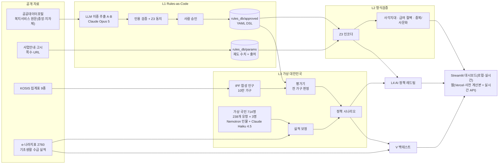

- **판정 엔진은 하나입니다.** 같은 규칙 YAML 을 Python 평가기(분수 연산 `Fraction`, 판정 근거 trace)와 Z3 인코더가 함께 읽습니다. 두 엔진이 무작위 1,000가구에서 100% 같은 판정을 내는지 테스트로 확인합니다.
- **지역 판정:** 지자체 사업은 시도 + 시군구로 판정합니다. 규칙 세트에 지자체 사업이 있으면 Z3 가구 변수에 시군구 프로필이 자동으로 붙습니다.
- **비용 통제:** LLM 호출은 `.cache/llm/` 캐시를 거칩니다. 에이전트 시뮬레이션은 가구 10만 개가 아니라 238개 유형 × 가상 인물 3명(714명) 단위로 호출합니다. 지금까지 LLM 비용은 약 $14(Haiku 약 $13.2, Opus 약 $0.9)입니다.
- **오프라인 데모:** `welfaretwin.demo_bundle` 이 대시보드용 사전 계산본(`artifacts/demo/`)을, `welfaretwin.web_export` 가 정적 웹 데이터(`web/data/`)를 만듭니다. 네트워크가 없어도 데모가 돕니다.

| 영역 | 사용 기술 |
|---|---|
| 규칙·검증 | Python 3.12, 자체 YAML DSL(ast 화이트리스트 선형식), z3-solver 5.3.3, pydantic, PyYAML |
| 데이터·인구 | httpx(공공데이터포털·KOSIS API), pandas 3.1, numpy, pyarrow, IPF(반복 비례 조정) |
| LLM | Anthropic SDK 2.7 — 규칙 추출 `WT_LLM_MODEL`(claude-opus-5), 에이전트·레드팀 `WT_LLM_MODEL_AGENT`(claude-haiku-4-5) |
| 화면 | Streamlit 1.67 + Plotly 7.1(로컬), 정적 HTML + Plotly.js 2.35 · Pretendard · Noto Serif KR(웹) |
| 배포·테스트 | Vercel(GitHub `main` 푸시 시 자동 배포), pytest · hypothesis(속성 기반 테스트), Playwright(리허설 자동 점검) |

## Rules-as-Code

### 규칙 한 건은 이렇게 생겼습니다

[`rules_db/approved/LOCAL_WLF00005691.yaml`](rules_db/approved/LOCAL_WLF00005691.yaml) (경북 구미시 청년월세 지원사업)에서 발췌:

```yaml
eligibility:
  all:
  - expr: count(p.age >= 19 and p.age <= 39) >= 1
    label: 19~39세 청년 가구원
    quote: 관내 거주 19세~39세 이하 부모님과 별도 거주 중인 무주택 미혼 청년
  - expr: nbls_income_recognized <= round(median_income(hh.size) * 120 / 100)
    label: 소득 기준중위소득 120% 이하
    quote: '- (소득) 청년가구 기준 중위소득 120% 이하'
    uncertain: true
  - expr: not (elig('NBLS_LIVELIHOOD') or elig('NBLS_MEDICAL') or elig('NBLS_HOUSING') or elig('NBLS_EDUCATION'))
    label: 기초생활수급자 제외
    quote: '※ 제외대상 : 기초생활수급자(생계, 의료, 주거, 교육)'
benefit:
  monthly: '100000'
not_modeled:
- quote: 2촌 이내 주택 임차자
  reason: 임대인과의 친족 관계는 표현 불가
```

- 조건마다 **원문 인용(`quote`)** 을 붙이고, 인용이 원문에 글자 그대로 있는지 자동으로 확인합니다.
- 표현하지 못한 조건은 지우지 않고 `not_modeled` 에 남깁니다. 화면에 '담당자 확인 필요'로 표시합니다.
- 기준중위소득·선정기준 비율·재산 환산율 같은 제도 수치는 코드에 쓰지 않고 [`rules_db/params/2026.yaml`](rules_db/params/2026.yaml) 에 출처와 함께 둡니다. 출처를 확인하지 못한 값은 `verified: false` 로 표시합니다.

### LLM 추출 → 교차검증 → 사람 승인

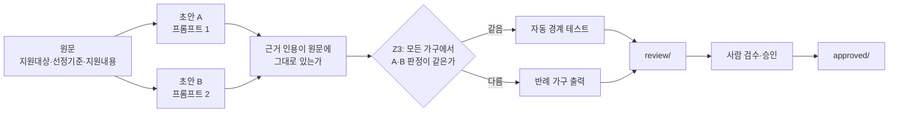

- 12건 중 9건은 A·B 판정이 같다는 것을 Z3 가 증명했습니다. 3건은 판정이 갈리는 반례 가구가 나왔고, 반례를 보고 누락 조건을 찾아 사람이 고쳤습니다(수정 내역은 규칙의 `provenance.human_edits`). A·B 가 함께 틀린 공통 오류 1건도 검수에서 고쳤습니다.
- 명령: `uv run python -m welfaretwin.rules.pipeline run <servId...>` → `review/`, `uv run python -m welfaretwin.rules.pipeline approve <ID>` → `approved/`.

## 형식검증(Z3)

- **인코딩:** 가구(가구원 나이·장애, 소득 원천, 재산, 주거 형태, 시도·시군구)를 Z3 변수로 두고, 승인된 규칙 전체를 제약식으로 바꿉니다. 기초연금이 생계급여 소득인정액에 다시 들어가는 식의 제도 간 상호작용도 그대로 들어갑니다(사업안내 p.122).
- **설명:** 찾은 가구는 사람이 읽는 문장으로 바꾸고, 제도별 탈락 조항과 근거(사업안내 쪽수)를 붙입니다.
- **규모 추정:** Z3 가 '존재'를 증명한 유형이 실제로 몇 가구인지는 합성 인구에서 셉니다(사각지대 73,783가구).
- 명령: `uv run python -m welfaretwin.verify.run --query all` (`blindspot` · `cliff` · `overlap`)

## 가상 대한민국(합성 인구 + AI 에이전트)

| 단계 | 내용 | 검증 |
|---|---|---|
| 합성 인구 | KOSIS 집계표 9종(시도·시군구 × 가구주 연령 × 가구원수, 점유형태, 소득구간, 소득원천, 자산·부채, 장애)으로 IPF → 100,000가구 / 216,234명(가중치 224.9) | 주변분포 최대 오차 0.05%p, 소득 P50 합성 5,373 vs KOSIS 5,800만원 |
| 전 가구 판정 | 승인된 규칙으로 10만 가구 전부를 평가 | 기초생활보장 자격 2,664,975가구 vs 2025 실제 수급 2,013,319가구(1.32배 = 비수급 + 단순화 오차) |
| 신청 행동 | 층화 유형 238개마다 조건(가구주 나이·가구 형태·지역·취업)이 맞는 [Nemotron-Personas-Korea](https://huggingface.co/datasets/nvidia/Nemotron-Personas-Korea) 가상 인물 3명(714명)이 1인칭으로 신청 의향·이유를 답함(Claude Haiku 4.5, $4.07). 경제 상황은 합성 인구 값 | 714명 모두 조건 완화 없이 매칭, 같은 유형 안 응답 표준편차 0.09(이전 집단 설명 방식 0.024) |
| 실적 보정 | 공통 절편 b=1.94 로 2025 실제 수급 가구 수에 맞춤. AI 는 방향·상대 크기만, 수준은 실제 통계가 맡음 | 현행 수급률 75.5%, 미신청 651,656가구 |
| 시나리오 | 선정기준 × 신청 방식, 지역 필터, 새로 포함/탈락 가구 유형 | 자동 안내 +312,897가구 / 생계 32→35% 생계 자격 +216,176가구 |

<p align="center">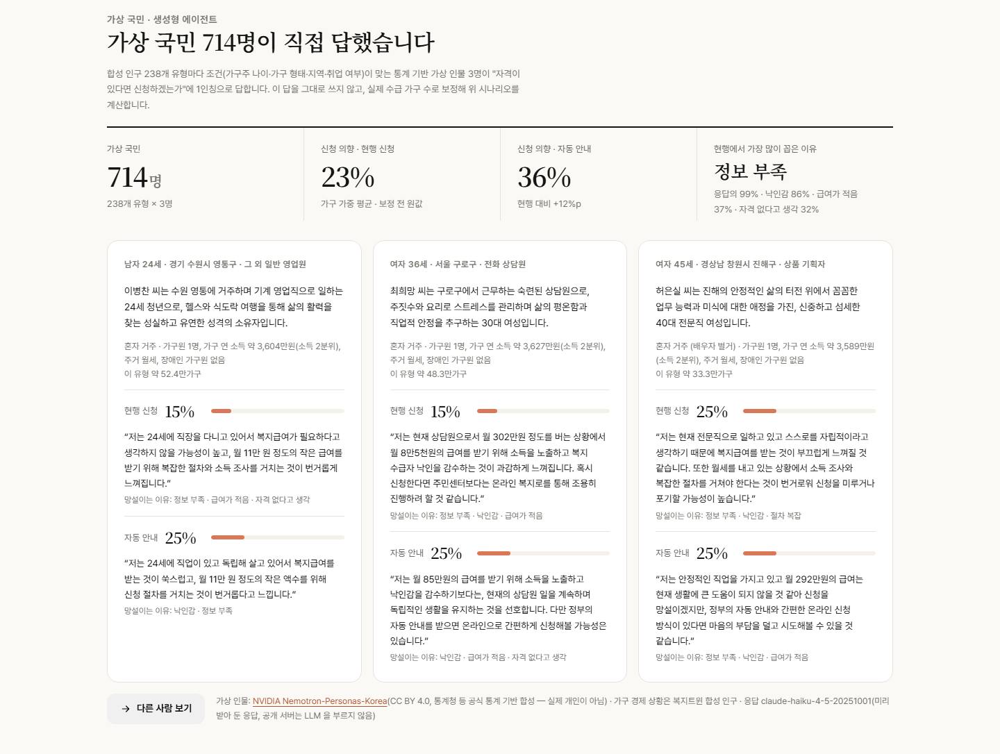</p>
<p align="center"><sub>웹 04 시뮬레이터의 '가상 국민' 절(2026-11-11 캡처). 인물은 NVIDIA Nemotron-Personas-Korea(CC BY 4.0, 통계 기반 합성 — 실제 개인 아님), 가구 경제 상황은 합성 인구 값. 확률은 보정 전 원값이고 '다른 사람 보기'로 24명을 넘겨 봅니다.</sub></p>

**AI 정책 레드팀** 은 사업안 한 줄을 규칙으로 옮긴 뒤 영향(대상 가구·재정), 배제 위험(조건 하나로 탈락하는 유형, Z3), 허점(작은 변경으로 자격을 얻는 경로와 보완안), 급여 절벽, 행정 부담(확인 단계·중복 확인 제도)을 점검합니다. 허점은 방어 목적의 설계 점검으로만 서술합니다. 명령: `uv run python -m welfaretwin.redteam.report --preset heating`

## 백테스트

과거 제도 변화를 재현해 실제 수급 통계와 비교합니다. 오차를 숨기지 않고 공개합니다.

| 항목 | 예측 | 실제(e-나라지표) | 오차율 |
|---|---|---|---|
| B2 2024→2025 수급 가구 증가 | +117,426 | +129,230 | **9.1%** (목표 ±10% 달성) |
| 같은 기간 수급 인원 증가 | — | — | 16.8% (미달) |
| 비교: 인구 소득·자산 고정 | — | — | 76.4% |

- 가구 소득·자산 증가(가계동향·가계금융복지조사 공표 증가율)를 반영해 76.4% → 9.1% 로 줄었습니다. 증가율 출처는 [`rules_db/params/backtest_growth.yaml`](rules_db/params/backtest_growth.yaml) 에 있습니다.
- 연도별 기준값은 [`backtest_2024.yaml`](rules_db/params/backtest_2024.yaml)·[`backtest_2025.yaml`](rules_db/params/backtest_2025.yaml) 에 고시·보도자료 문서명과 URL 을 붙여 두었습니다(예: 노인 근로소득 추가공제 2024년 75세 이상, 2025년부터 65세 이상).
- 명령: `uv run python -m welfaretwin.backtest.run` (`--no-growth` 로 고정 인구 비교)

## 빠른 시작과 재현

```bash
uv sync
uv run streamlit run app/dashboard.py --server.headless true   # 사전 계산본(artifacts/demo)으로 오프라인 동작
uv run pytest -q                                               # 2026-11-11 기준 194 passed, 1 skipped
```

- 화면: 01 복지 법전 → 코드 / 02 사각지대 / 03 급여 절벽 / 04 정책 시뮬레이터 + 레드팀 / 05 백테스트. 사이드바 '모드'에서 실시간 실행(Z3·평가기·LLM 캐시)으로 바꿀 수 있습니다.
- `uv` 가 PATH 에 없으면 `%APPDATA%/Python/Python313/Scripts/uv.exe` 를 씁니다. `--server.headless true` 가 없으면 Streamlit 첫 실행 안내에서 멈춥니다.
- 건너뛰는 테스트 1건은 `test_params.py` 의 '출처 미확인 값' 점검입니다. 미확인 값이 없으면 건너뜁니다.

### 전체 재현

[`.env.example`](.env.example) 을 `.env` 로 복사해 키를 채웁니다(공공데이터포털, KOSIS, Anthropic). `.env` 는 커밋하지 않습니다.

```bash
uv run python -m welfaretwin.data.collect --source central --source local   # 복지서비스 원문(일일 한도 → 이어받기)
uv run python -m welfaretwin.data.stats                            # e-나라지표 수급 통계
uv run python -m welfaretwin.population.synth                      # 합성 인구 10만 가구(KOSIS 캐시 data/raw/kosis)
uv run python -m welfaretwin.sim.static                            # 전 가구 평가 + 실적 대비 보정 리포트
uv run python -m welfaretwin.verify.run --query all                # Z3 사각지대·급여 절벽·중복/사문화
uv run python -m welfaretwin.rules.pipeline run WLF00005691 ...    # 지자체 사업 LLM 추출(A·B) → 교차검증 → review/
uv run python -m welfaretwin.rules.pipeline approve LOCAL_WLF00005691   # 사람 승인
uv run python -m welfaretwin.agents.behavior                       # 페르소나 행동 응답(LLM, 캐시)
uv run python -m welfaretwin.sim.scenario --preset demo            # 정책 시나리오(실수급 통계 보정)
uv run python -m welfaretwin.redteam.report --preset heating       # 사업안 레드팀 리포트
uv run python -m welfaretwin.backtest.run                          # 백테스트(B2 2024→2025)
uv run python -m welfaretwin.demo_bundle                           # 대시보드용 사전 계산본
uv run python -m welfaretwin.web_export                            # 정적 웹 데이터(web/data/) → 커밋·푸시하면 Vercel 자동 배포
uv run python -m welfaretwin.report_eval                           # 평가 리포트(reports/eval_*.md)
python app/rehearsal.py --rounds 3 --shots artifacts/rehearsal     # 데모 리허설 자동 점검(대시보드 실행 중)
```

### 운영

- 공공데이터포털 개발계정 일일 한도(중앙 약 100건, 지자체 약 1,000건) 때문에 원문은 매일 이어받습니다. `scripts/register_collect_task.cmd` 가 매일 01:30 예약 작업을 등록합니다(해제 `schtasks /Delete /TN WelfareTwin_Collect /F`, 로그 `.cache/collect_daily.log`, PC 가 켜져 있어야 실행).
- 2026-11-10 기준 상세 수집: 중앙 99/461건, 지자체 998/4,828건(대구·경북 사업은 전부 수집).

## 저장소 구조

```
├─ src/welfaretwin/
│  ├─ data/          # 공공데이터포털 복지서비스 API(이어받기·한도 처리), KOSIS, e-나라지표
│  ├─ rules/         # DSL·식 파서·평가기·소득인정액·LLM 추출·교차검증·테스트 생성·파이프라인
│  ├─ verify/        # Z3 인코더, 질의(사각지대·절벽·중복), 설명문
│  ├─ population/    # KOSIS 표, IPF, 합성 인구, 페르소나
│  ├─ agents/        # LLM 호출(역할별 모델·캐시), 신청 행동
│  ├─ sim/           # 전 가구 평가, 시나리오·보정
│  ├─ redteam/       # 사업안 레드팀
│  ├─ backtest/      # 백테스트
│  ├─ api/           # 실시간 계산 서버(FastAPI)
│  ├─ demo_bundle.py · web_export.py · report_eval.py
├─ rules_db/
│  ├─ approved/      # 승인된 규칙(중앙 7종 + 지자체 12건 + 소득인정액 라이브러리)
│  ├─ review/ · draft/
│  └─ params/        # 2026.yaml, backtest_2024/2025.yaml, backtest_growth.yaml — 수치 + 출처
├─ app/              # Streamlit 대시보드, 리허설 자동 점검(Playwright)
├─ web/              # 정적 웹 데모(index.html, data/, og.png) — Vercel 출력 폴더
├─ artifacts/        # 사전 계산본(demo/), 백테스트·시뮬레이션 결과, 리허설 캡처·백업 영상
├─ data/             # 수집 원문·통계 캐시(KOSIS 캐시만 커밋), processed/
├─ reports/          # 평가 리포트, 추출 리포트
├─ docs/             # 설계서 00~12, images/
├─ deploy/space/     # Docker 이미지(Dockerfile, Hugging Face Space 설명)
├─ tests/            # pytest 195개(속성 기반 포함)
└─ scripts/          # 원문 일일 수집 예약 작업, 실시간 API 배포(deploy_api.py)
```

## 한계

- **부양의무자·특례 미반영:** 사각지대 규모는 부양의무자 기준과 각종 특례를 반영하지 않은 단순화 결과입니다(가족관계 데이터 없음). 그래서 B1 백테스트(2021.10 생계급여 부양의무자 기준 폐지)는 하지 않았습니다.
- **인원 기준 오차 16.8%:** 가구 기준은 목표 ±10% 를 맞췄지만 인원 기준은 미달입니다.
- **가상 국민의 한계:** Nemotron 인물은 변수를 서로 독립으로 뽑았고(데이터 카드) 소득·재산이 없어, 경제 상황은 합성 인구 값을 쓰고 인물은 성격·가족·지역·직업만 맡습니다. LLM 이 답한 신청 확률은 그대로 쓰지 않고 실제 수급 통계로 보정합니다 — 보정 후 현행 수준은 같고, 바뀌는 것은 '변화의 방향과 크기'(자동 안내 +283,241 → +312,897가구)입니다. 이전 방식(집단 설명 3회 표본)과의 비교는 [`reports/eval_20261111.md`](reports/eval_20261111.md) §4.
- **균일 증가율:** 백테스트의 소득·자산 증가는 전국 평균 증가율을 모든 가구에 같은 비율로 적용합니다(저소득층의 다른 증가율 미반영). 연도별 값을 확인하지 못한 공제 항목은 2026 값을 씁니다.
- **실적에 섞인 요인:** 실제 수급자 증감에는 경기·신청 행태·제도 운영 변화가 함께 들어 있습니다.
- **지자체 사업 범위:** LLM 추출·승인한 지자체 사업은 대구·경북 12건입니다. 원문 수집은 일일 한도 때문에 진행 중입니다.
- **표현하지 못한 조건:** 혼인 상태, 임대인과의 관계, 타 사업 수혜 여부처럼 변수가 없는 조건은 `not_modeled` 로 남기고, 대상이 과대 추정될 수 있음을 규칙의 `assumptions` 에 적었습니다.
- **합성 인구:** IPF 는 500회 반복에서 완전히 수렴하지 않았습니다(시도×연령×점유형태 2020 비율 기준 최대 상대오차 16.8%). 주변분포 오차는 0.05%p 이내입니다.
- **공개 웹의 범위:** 실시간 서버는 LLM 을 부르지 않으므로 사업안 자연어 입력·레드팀 새로 실행은 로컬 대시보드에서만 됩니다. 서버는 Vercel 무료 요금제(1 vCPU)라 첫 요청은 준비에 몇 초 더 걸리고, 무거운 계산은 한 번에 하나만 받습니다. 연결이 안 되면 사전 계산본을 보여 줍니다.

## FAQ

<details>
<summary><b>LLM 이 만든 규칙을 어떻게 믿나요?</b></summary>

믿지 않고 검증합니다. 서로 다른 프롬프트로 두 번 추출하고, 조건마다 붙인 원문 인용이 글자 그대로 있는지 확인하고, Z3 로 두 초안의 판정이 모든 가구에서 같은지 증명합니다. 다르면 판정이 갈리는 반례 가구가 나오고, 사람이 그 가구를 보고 고친 뒤 승인해야 `approved/` 로 올라갑니다.
</details>

<details>
<summary><b>왜 샘플링이 아니라 형식검증인가요?</b></summary>

사각지대나 급여 절벽은 특정 소득·재산·가구 구성 조합에서만 생깁니다. 무작위 가구를 많이 뽑아도 그 좁은 구간을 놓칠 수 있습니다. Z3 는 "그런 가구가 존재하는가"에 대해 존재하면 실제 예시를, 없으면 없다는 증명을 돌려줍니다. 규모(몇 가구인가)는 그다음에 합성 인구에서 셉니다.
</details>

<details>
<summary><b>AI 에이전트의 신청 확률은 지어낸 숫자 아닌가요?</b></summary>

AI 는 페르소나 사이의 **방향과 상대 크기**만 정합니다. 수준은 공통 절편 하나로 2025년 실제 수급 가구 수(2,013,319가구, e-나라지표 2760)에 맞춥니다. 그리고 과거 제도 변화를 재현하는 백테스트로 오차를 공개합니다.
</details>

<details>
<summary><b>개인정보는요?</b></summary>

실제 개인 단위 데이터는 쓰지 않습니다. KOSIS 공개 집계표로 만든 합성 가구만 씁니다. 화면에 나오는 '가구'는 모두 Z3 가 만든 예시이거나 합성 가구입니다.
</details>

<details>
<summary><b>심사 중에 서버가 죽으면요?</b></summary>

웹 데모는 정적 파일이라 서버 연산이 없습니다. 로컬 대시보드도 사전 계산본으로 네트워크 없이 돌고, 그래도 안 되면 백업 영상(`artifacts/rehearsal/demo_backup.webm`)이 있습니다.
</details>

## 일정

| 날짜(2026) | 이벤트 | 상태 |
|---|---|---|
| 11-20(금) | 서류 접수 마감 | 제안서 완료 |
| 11-23(월) | 서류심사 | — |
| 11-25(수) | 본선 진출 발표 | MVP 핵심(M1~M3) 동작 |
| 12-03(목) | 본선 발표(5분 발표 + 5분 질의) | 데모·대본·백업 영상 준비, 사람 리허설 남음 |

## 문서 지도

| 문서 | 내용 |
|---|---|
| [`docs/00_README.md`](docs/00_README.md) | 전체 개요·문서 목록 |
| [`docs/01_구현계획서.md`](docs/01_구현계획서.md) | 마일스톤·WBS·체크리스트 — **진행 상황의 단일 기준** |
| [`docs/02_시스템_아키텍처.md`](docs/02_시스템_아키텍처.md) | 구성요소·디렉터리 구조 |
| [`docs/03_데이터_설계.md`](docs/03_데이터_설계.md) | 데이터 소스·수집·스키마 |
| [`docs/04_RulesAsCode_설계.md`](docs/04_RulesAsCode_설계.md) | 규칙 DSL·LLM 추출·교차검증 |
| [`docs/05_형식검증_설계.md`](docs/05_형식검증_설계.md) | Z3 인코딩·질의 |
| [`docs/06_합성인구_에이전트_설계.md`](docs/06_합성인구_에이전트_설계.md) | 합성 인구·LLM 에이전트·백테스트 |
| [`docs/07_레드팀_설계.md`](docs/07_레드팀_설계.md) | 정책 레드팀 |
| [`docs/08_API_대시보드_설계.md`](docs/08_API_대시보드_설계.md) | API·화면 |
| [`docs/09_테스트_검증계획.md`](docs/09_테스트_검증계획.md) | 테스트·검증 계획 |
| [`docs/10_데모_발표_시나리오.md`](docs/10_데모_발표_시나리오.md) | 데모·발표 시나리오 |
| [`docs/11_질의응답_대비표.md`](docs/11_질의응답_대비표.md) | 질의응답 대비표 |
| [`docs/12_발표_대본.md`](docs/12_발표_대본.md) | 5분 발표 대본 |
| [`reports/eval_20261110.md`](reports/eval_20261110.md) | 평가 리포트 — 발표 수치는 여기서만 가져옴 |

## 데이터 출처·개인정보·AI 활용

| 자료 | 쓰임 |
|---|---|
| 공공데이터포털 한국사회보장정보원 복지서비스 API(중앙부처·지자체, B554287) | 지자체 사업 원문(지원대상·선정기준·지원내용) → LLM 규칙 추출 |
| 보건복지부 사업안내·고시(기준중위소득 등) | 제도 수치. `rules_db/params/*.yaml` 에 문서명·쪽수·URL 과 함께 |
| KOSIS 국가통계포털 집계표 9종 | 합성 인구(IPF) 주변분포·검증 |
| e-나라지표 2760 국민기초생활보장 수급 현황 | 행동 보정 목표, 백테스트 실제값 |
| [NVIDIA Nemotron-Personas-Korea](https://huggingface.co/datasets/nvidia/Nemotron-Personas-Korea) (CC BY 4.0) | 가상 국민 714명의 인물(나이·성별·가구 형태·시도·시군구·직업·인물 묘사). 통계 기반 합성 — 실제 개인 아님. 첫 조각(111,112명)에서 결정적으로 매칭 |

- **개인정보:** 실제 개인 단위 데이터 0건. 공개 집계표와 합성 가구만 씁니다.
- **비밀 관리:** API 키는 `.env`(커밋 금지)에만 둡니다. 정적 웹에는 키가 들어가지 않는지 테스트(`tests/test_web.py`)로 확인합니다.
- **AI 활용:** 규칙 추출은 Claude Opus 5, 가상 국민의 신청 행동 응답·레드팀은 Claude Haiku 4.5 를 씁니다. 모든 응답은 캐시하고, 규칙은 교차검증·테스트·사람 승인을 거칩니다. 이 저장소의 코드·문서 작성에는 Claude Code 를 함께 썼습니다.

<div align="center">

**사람에게 실험하기 전에, 코드로 먼저 증명합니다.**

</div>
